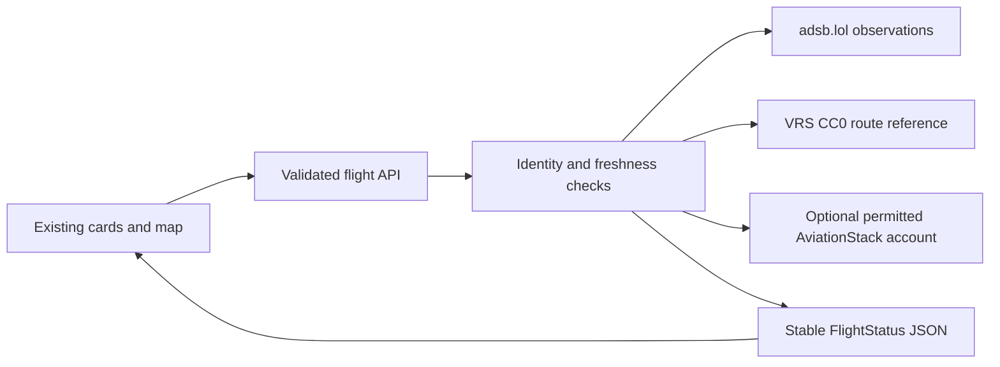

# Flight data contract and provider decisions

Updated 2026-11-09. The UI consumes the application-owned `FlightStatus` shape in `src/lib/flight-types.ts`, never a provider response directly. The keys used by the existing cards and maps remain grouped under `departure`, `arrival`, `aircraft` and `liveData`. Unavailable values are JSON null. This is a deliberate contract change from fabricated defaults, and every consumer must handle null.



## Field cross-check

| UI key | Provider mapping and unit | Missing or uncertain data |
|---|---|---|
| `flightNumber` | Normalized requested identifier, matching observed callsign or known carrier alias | An alias is a lookup aid, not a universal marketing-to-operating flight resolver |
| `flightDate` | Matching schedule's service date | Null without a dated schedule |
| `airline` | Matched operational record, or an explicitly identified carrier reference if implemented | Null if not known |
| `departure/arrival.airport`, `.code`, `.latitude`, `.longitude` | Matching schedule/local airport coordinates; otherwise a geographically screened VRS reference route | A reference route is labeled unconfirmed. Unknown coordinates are null and no route line/airport marker is drawn |
| `departure/arrival.timezone` | Provider IANA timezone where available | Null, not a fabricated fixed offset |
| `departure/arrival.scheduledTime` | Offset-bearing schedule timestamp, normalized to ISO UTC | Null; never last contact or current time |
| `departure/arrival.estimatedTime` | Provider-reported estimate distinct from schedule and actual | Null; never current time plus two hours |
| `departure/arrival.actualTime` | Provider-reported actual movement timestamp | Null; on-ground telemetry does not establish gate arrival |
| `departure/arrival.terminal`, `.gate` | Matched operational record | Null and shown as unavailable |
| `aircraft.model`, `.registration` | ADS-B database enrichment `t` and `r`, or permitted operational metadata | Null; the Mode-S hex identifier is not a registration |
| `aircraft.speed` | ADS-B `gs`, knots | Null when absent; real zero stays zero |
| `aircraft.altitude` | ADS-B barometric altitude, feet; validated geometric fallback only where implemented | Null when unknown. A ground flag is not a measured altitude |
| `aircraft.heading` | Existing key retained for compatibility, carrying ADS-B true ground track in degrees | UI labels this as direction/track, not measured aircraft heading |
| `liveData.latitude`, `.longitude` | Validated finite observed decimal degrees | Null when only schedule is available; zero is a valid coordinate |
| `liveData.progress`, `.remainingTime` | Only where the source and basis support an explicit result | Null without adequate evidence; a reference route alone does not justify a countdown or completion percentage |
| `status` | Matched provider operational status, otherwise observed airborne/surface state | Surface is On Ground, not Landed. Empty coverage is not cancelled |
| `dataSources` | Actual position, route and schedule sources used | Null for absent categories |
| `dataQuality` | Original position timestamp, fetch timestamp, route confidence, missing paths and warnings | Cache reads must not reset observation age |

## Active and historical endpoints

- Map tiles are a separate browser request, independent of flight JSON. The old CARTO tile URL rendered an API KEY REQUIRED image during desktop/mobile review despite the flight endpoint returning 200. CARTO now documents a key on its raster URL. This repair uses `https://tile.openstreetmap.org/{z}/{x}/{y}.png`, visible OpenStreetMap contributor attribution, ordinary browser caching and Referer behavior, and no bulk prefetch. Standard OSM tiles are best effort and capacity-limited; this is not unlimited free hosting or an SLA. No CARTO account/key was created or changed. See the [OSM tile policy](https://operations.osmfoundation.org/policies/tiles/) and [CARTO basemap documentation](https://carto.com/basemaps).
- Default live source: `https://api.adsb.lol/v2/callsign/{callsign}`, with ODbL attribution. No provider key is required for the tested public endpoint. Availability and receiver coverage remain best effort.
- Optional, explicitly selected alternate feeds are subject to provider permission and access terms. An accessible URL is not evidence of commercial/public-product permission. The default path does not depend on OpenSky or Airplanes.live access.
- Route reference: fixed raw GitHub paths in `vradarserver/standing-data` pinned at `7db1e656f68f7bb4064b92c345ea0937a0ea44db`, CC0. Exact callsign and two-airport records only; ambiguous/multi-leg records and geographically conflicting routes are omitted. This is historical/reference data, not today's confirmed service.
- Optional operational enrichment: AviationStack HTTPS `/v1/flights`, server-side key only, explicitly enabled account/use case. No automatic subscription, HTTP downgrade or new paid account.
- Retired from the active call chain: Amadeus Self-Service test APIs and FlightAware HTML scraping. Historical source files remain for reference. Amadeus's official developer organization is deprecated/archived; the old test hostname failed DNS resolution. FlightAware returned 402 during the live audit, and scraping is not a supported JSON contract.
- Not adopted: adsbdb route publication without the stated permission; adsb.lol routeset returned an empty response in the live probe. FlyItalyADSB is a promising eligible free fallback requiring separate account/key onboarding. No account was created.

## Boundaries and reliability

The route accepts a flight identifier, never an arbitrary upstream URL. Provider hosts are fixed/allowlisted. Keys remain server-side, raw provider errors and access-bearing URLs are not returned or logged, and client code imports only the public contract/client wrapper. Invalid input returns 400. No recent observation returns a specific not-observed response, distinct from upstream unavailability. Optional metadata failure must not erase usable live telemetry. Every network path has a deadline; short-lived bounded caches and request deduplication reduce duplicate calls. Memory caches are per process, not a guaranteed distributed quota limit across Vercel instances.

The UI preserves available data after a refresh failure and makes the failure visible. It must never label an old successful fetch as a new observation, plot a fake aircraft at 0,0, format null as a date/number, or infer landing solely because a clock ran out.

No free, permission-cleared source was verified to supply every existing UI field worldwide. Preserving the UI means every field has a defined mapping and missing-data state, not a promise that providers always populate it.

## Public-release checks, 2026-11-10

The owner authorized production release and restoration of the existing project key.
`AVIATION_STACK_KEY` was restored as a Production Secret and `DATA_SOURCE=hybrid`
as Production configuration. No key was printed, written into code/browser config,
or copied into the vault. The preserved project `.env.local` was the source used for
the authorized transfer through CLI stdin. Local secret files were not uploaded;
the deployment builds the exact pushed GitHub commit.

Public testing exposed three narrow follow-ups. A uniquely matched completed flight
can now remain available for 24 hours, with its actual service date and a notice for
older completed records. Active/current/upcoming records still take precedence and
ambiguous matches remain unresolved. A historical result is used only when there is
no fresh current aircraft position. Its itinerary, date and Landed status are never
attached to a current aircraft just because the callsign is reused. A reported Landed
schedule is also ignored when it conflicts with a fresh airborne observation. The
historical selection marker remains server-internal and is not added to public JSON.
This is not a full historical search API.
When a schedule airport lacks provider/local coordinates, its validated ICAO code
can use the existing pinned CC0 airport dataset with bounded requests and caches.
This supplies a missing route endpoint such as PHKO/KOA without inventing a plane
position or changing the schedule's itinerary confidence. Expired arrival estimates
do not produce a current Early/On Time badge.

Route lines are endpoint-based guides, not a recorded trail of everywhere the plane
has flown. Ground track rotates the airplane icon clockwise from north. Provider
coverage and missing fields remain explicit; no claim of every flight/field worldwide
is made. Exact release/CI and rendered verification are in `TEST-LEDGER.md`.

Release `dfc43013c499ff3faa9860967ce725ee1959fa6a` is deployed and verified on the
public alias. SWA1781/WN1781 return the dated completed service; UAL1759 returned
fresh telemetry, a rendered route and all three map markers, including the previously
missing KOA endpoint. Public browser direction matched the returned track value.
Public tests do not establish complete worldwide coverage or airline-certified accuracy.

## Existing schedule key: real compatibility check

A subsequent direct check confirmed the existing local AviationStack key works over
HTTPS. With a temporary local `DATA_SOURCE=hybrid` process, both SWA1781 and WN1781
returned dated schedule-only results after recent ADS-B coverage stopped. The real
response populated DEN gate C65, SAN terminal 1/gate 103, aircraft B38M and registration
N9021F. Provider status changed from Delayed to Landed between probes. The adapter
preserved supplied timestamps and displayed them in airport timezones, left missing
telemetry null, and drew airport markers without a fabricated aircraft position.

This proves current key validity and actual JSON/UI compatibility for those responses,
not all-airline completeness, a free account tier, remaining quota or independently
confirmed airline accuracy. Provider times/status may lag or contain errors; no offset
was silently changed to make the result look right. No new account or plan was purchased.
Local test polling was stopped after capture to avoid continued schedule API usage.

Production still has no key or hybrid setting. The key was not found in the canonical
vault. The owner's supplied rule requires them to add missing vault keys before
credential restoration; no key was copied, stored or printed by this repair. Deployment
and restoration of `AVIATION_STACK_KEY` plus `DATA_SOURCE=hybrid` require approval.

## Diagram source and rendering

The visual overview is generated from [`diagrams/flight-data-flow.json`](diagrams/flight-data-flow.json) with the shared [clean-diagram renderer](../../../claude-code-powerkit/skills/clean-diagram/render.py). The HTML and PNG beside the JSON are generated outputs; change the JSON and render again rather than editing those outputs.

Verified local render command:

```sh
mkdir -p .tmp
python3 -m venv .tmp/diagram-venv
.tmp/diagram-venv/bin/pip install playwright==1.60.0
mkdir -p .tmp/pw-browsers
ln -sfn "$HOME/Library/Caches/ms-playwright/chromium-1248" .tmp/pw-browsers/chromium-1223
ln -sfn "$HOME/Library/Caches/ms-playwright/chromium_headless_shell-1248" .tmp/pw-browsers/chromium_headless_shell-1223
PLAYWRIGHT_BROWSERS_PATH="$PWD/.tmp/pw-browsers" .tmp/diagram-venv/bin/python \
  /Users/booly/Desktop/CODE/claude-code-powerkit/skills/clean-diagram/render.py \
  docs/diagrams/flight-data-flow.json --strict
```

The renderer uses Python Playwright and headless Chromium. For this render, Playwright 1.60.0 was installed in the project scratch venv and launched the already-cached Chromium 156 binary through a project-local revision alias; no browser download was needed. On another machine, use an installed Playwright Chromium matching that local package, or install Chromium with Playwright before rendering. `--strict` checks layout and writes the HTML and PNG from the JSON source.

## Research and history

- [Provider comparison](research/2026-11-09-flight-data-providers.md)
- [Perplexity research and independent checks](research/2026-11-09-perplexity-flight-data.md)
- [Vercel configuration history and attribution limits](research/2026-11-09-flight-configuration-history.md)

No available evidence identifies who cleared the Vercel variables or whether they were ever set. The August security change removed browser-exposed fallback names, not server configuration. Do not turn that into an accusation or restore public credential prefixes.
